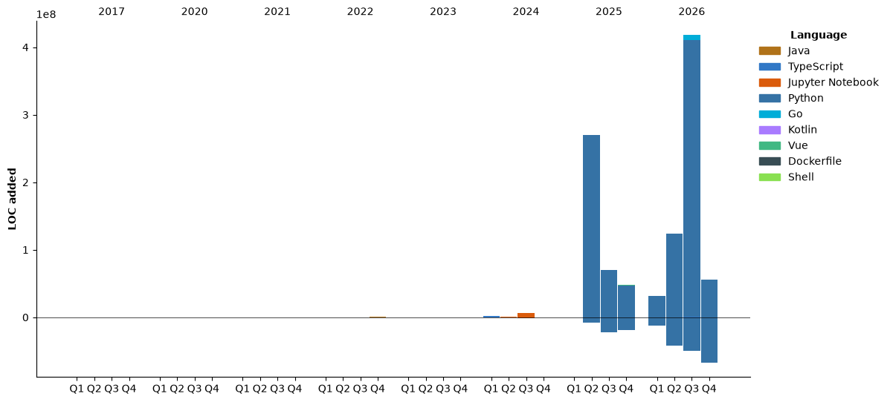

[](https://github.com/anuraghazra/github-readme-stats)

<!--START_SECTION:waka-->


**🐱 My GitHub Data** 

> 📦 ? Used in GitHub's Storage 
 > 
> 🏆 4,223 Contributions in the Year 2026
 > 
> 💼 Opted to Hire
 > 
> 📜 49 Public Repositories 
 > 
> 🔑 0 Private Repositories 
 > 
**I'm an Early 🐤** 

```text
🌞 Morning                201872 commits      ████░░░░░░░░░░░░░░░░░░░░░   17.45 % 
🌆 Daytime                759565 commits      ████████████████░░░░░░░░░   65.67 % 
🌃 Evening                187084 commits      ████░░░░░░░░░░░░░░░░░░░░░   16.17 % 
🌙 Night                  8138 commits        ░░░░░░░░░░░░░░░░░░░░░░░░░   00.70 % 
```
📅 **I'm Most Productive on Tuesday** 

```text
Monday                   169779 commits      ████░░░░░░░░░░░░░░░░░░░░░   14.68 % 
Tuesday                  257301 commits      ██████░░░░░░░░░░░░░░░░░░░   22.25 % 
Wednesday                222179 commits      █████░░░░░░░░░░░░░░░░░░░░   19.21 % 
Thursday                 210118 commits      █████░░░░░░░░░░░░░░░░░░░░   18.17 % 
Friday                   199572 commits      ████░░░░░░░░░░░░░░░░░░░░░   17.25 % 
Saturday                 54458 commits       █░░░░░░░░░░░░░░░░░░░░░░░░   04.71 % 
Sunday                   43252 commits       █░░░░░░░░░░░░░░░░░░░░░░░░   03.74 % 
```


📊 **This Week I Spent My Time On** 

```text
🕑︎ Time Zone: Asia/Seoul

💬 Programming Languages: 
No Activity Tracked This Week

🔥 Editors: 
No Activity Tracked This Week

🐱‍💻 Projects: 
No Activity Tracked This Week

💻 Operating System: 
No Activity Tracked This Week
```

🤖 **AI Coding This Week** 

```text
No AI Coding Activity Tracked This Week
```

**I Mostly Code in Java** 

```text
Python                   8 repos             █████░░░░░░░░░░░░░░░░░░░░   19.51 % 
Shell                    4 repos             ██░░░░░░░░░░░░░░░░░░░░░░░   09.76 % 
TypeScript               3 repos             ██░░░░░░░░░░░░░░░░░░░░░░░   07.32 % 
Go                       2 repos             █░░░░░░░░░░░░░░░░░░░░░░░░   04.88 % 
Vue                      1 repo              █░░░░░░░░░░░░░░░░░░░░░░░░   02.44 % 
```


**Timeline**




 Last Updated on 11/11/2026 05:58:58 UTC
<!--END_SECTION:waka-->