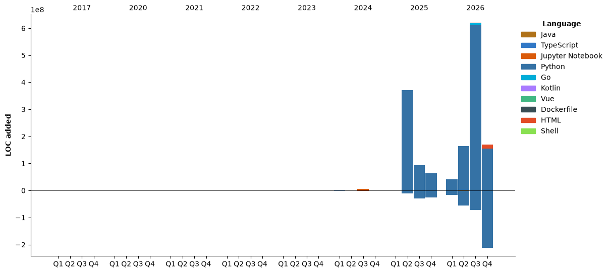

[](https://github.com/anuraghazra/github-readme-stats)

<!--START_SECTION:waka-->


**🐱 My GitHub Data** 

> 📦 ? Used in GitHub's Storage 
 > 
> 🏆 5,439 Contributions in the Year 2026
 > 
> 💼 Opted to Hire
 > 
> 📜 49 Public Repositories 
 > 
> 🔑 0 Private Repositories 
 > 
**I'm an Early 🐤** 

```text
🌞 Morning                343387 commits      █████░░░░░░░░░░░░░░░░░░░░   18.85 % 
🌆 Daytime                1166556 commits     ████████████████░░░░░░░░░   64.03 % 
🌃 Evening                298117 commits      ████░░░░░░░░░░░░░░░░░░░░░   16.36 % 
🌙 Night                  13716 commits       ░░░░░░░░░░░░░░░░░░░░░░░░░   00.75 % 
```
📅 **I'm Most Productive on Tuesday** 

```text
Monday                   264152 commits      ████░░░░░░░░░░░░░░░░░░░░░   14.50 % 
Tuesday                  388752 commits      █████░░░░░░░░░░░░░░░░░░░░   21.34 % 
Wednesday                341792 commits      █████░░░░░░░░░░░░░░░░░░░░   18.76 % 
Thursday                 335089 commits      █████░░░░░░░░░░░░░░░░░░░░   18.39 % 
Friday                   314370 commits      ████░░░░░░░░░░░░░░░░░░░░░   17.26 % 
Saturday                 105073 commits      █░░░░░░░░░░░░░░░░░░░░░░░░   05.77 % 
Sunday                   72548 commits       █░░░░░░░░░░░░░░░░░░░░░░░░   03.98 % 
```


📊 **This Week I Spent My Time On** 

```text
🕑︎ Time Zone: Asia/Seoul

💬 Programming Languages: 
No Activity Tracked This Week

🔥 Editors: 
No Activity Tracked This Week

🐱‍💻 Projects: 
No Activity Tracked This Week

💻 Operating System: 
No Activity Tracked This Week
```

🤖 **AI Coding This Week** 

```text
No AI Coding Activity Tracked This Week
```

**I Mostly Code in Java** 

```text
Python                   9 repos             █████░░░░░░░░░░░░░░░░░░░░   21.95 % 
TypeScript               3 repos             ██░░░░░░░░░░░░░░░░░░░░░░░   07.32 % 
Shell                    3 repos             ██░░░░░░░░░░░░░░░░░░░░░░░   07.32 % 
Dockerfile               2 repos             █░░░░░░░░░░░░░░░░░░░░░░░░   04.88 % 
Go                       2 repos             █░░░░░░░░░░░░░░░░░░░░░░░░   04.88 % 
```


**Timeline**




 Last Updated on 28/11/2026 05:28:46 UTC
<!--END_SECTION:waka-->